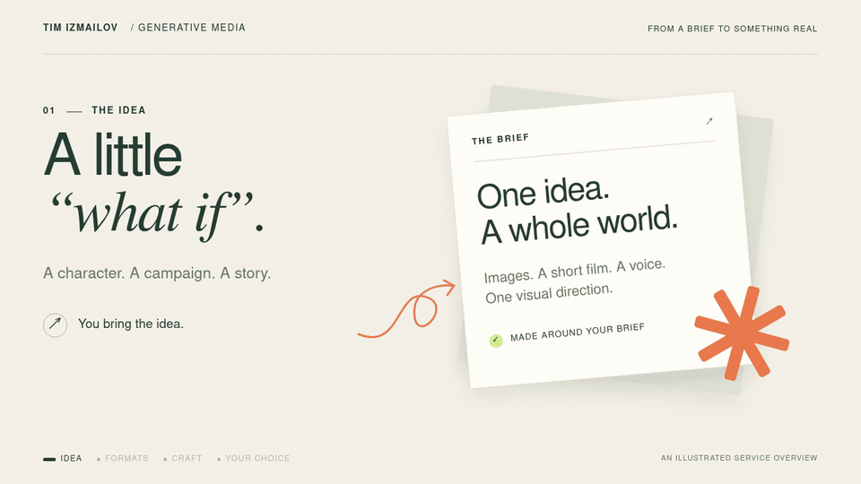

# Generative Media — Photo, Video & Voice

**From a first idea to finished content — or a production workflow your team can run.**

I handle model selection, GPU setup, generation, refinement and delivery. I draw on a curated collection of models and workflows, choosing around your subject, visual direction, formats and available hardware.

**Choose your starting point:** [Get finished media](#get-finished-media) · [Build my production workflow](#build-my-production-workflow)

*An illustrated service overview using an independent fictional campaign concept. [Still version](images/your-idea-ready-media-v2-poster.png) · [MP4 version](images/your-idea-ready-media-v2.mp4)*

## Building the AI Side of a Product

As **CTO of a confidential AI product**, I owned AI engineering across conversational, image, video and voice components.

The challenge was to bring image, video and voice generation into the product with consistent requirements for behavior, visual quality, latency and GPU resources. I selected models and hardware, developed and refined generation components, investigated defects, established quality checks, and coordinated integration with backend and design teams.

## Get Finished Media

For a campaign, character, product or content brief:

- Images with a coherent visual direction, including targeted editing and correction.
- Short video developed from still-image references and refined for the intended format.
- Voice and audio generation, with editing and postprocessing around the brief.

**You receive:** the agreed finished assets, prepared in the specified delivery formats.

## Build My Production Workflow

For a team that wants to produce its own content:

- Model and workflow selection around the brief, hardware and budget.
- GPU setup, image LoRA and data preparation where appropriate.
- Generation, quality-review and postprocessing steps, with a practical handover.

**You receive:** a configured workflow for the agreed task, setup notes and quality checks your team can use.

Send your desired result, a reference and the formats you need. We can define a focused first delivery from there.

[Discuss a project on Upwork](https://www.upwork.com/freelancers/~01d554f7011bd884f2) · [Connect on LinkedIn](https://www.linkedin.com/in/tim-izmailov-a53524283/)

Private project media, code, model configurations and training assets remain confidential.
