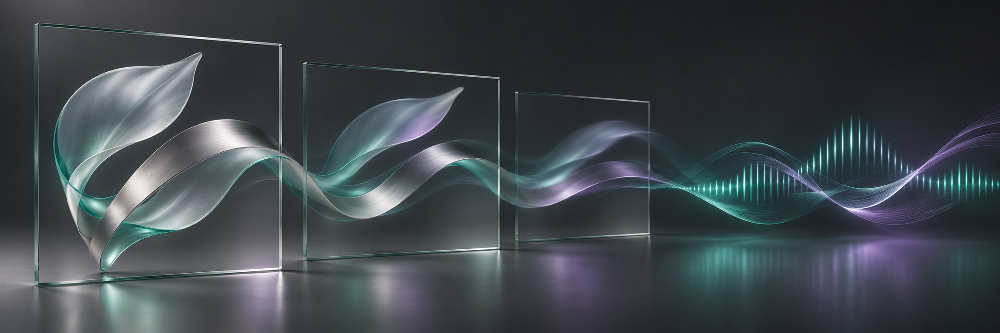
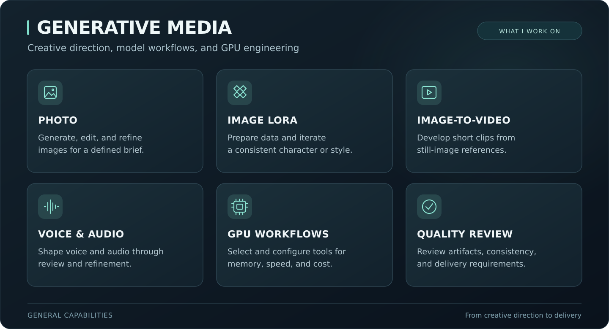
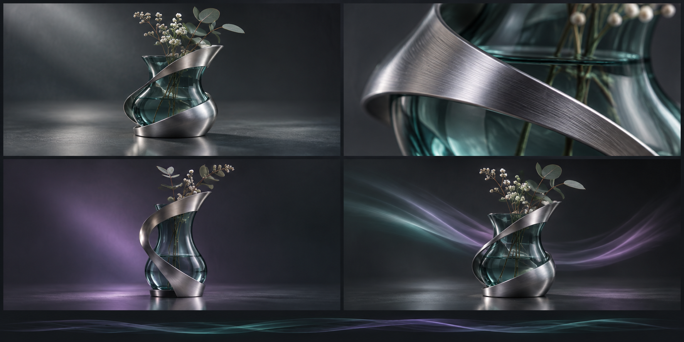

# Generative Media & GPU Workflows

**End-to-end image, video, and audio production · Image LoRA · GPU workflows**

I develop end-to-end generative-media workflows for AI products and content production: from model and workflow selection through image, video, and audio generation to quality review, postprocessing, and final delivery. My work combines creative direction with hands-on engineering and GPU infrastructure.

I maintain a curated collection of models and workflows for a broad range of generation tasks, subjects, styles, and output formats. I select and adapt the appropriate tools around each project's brief, quality requirements, hardware, and budget.

[Discuss a project on Upwork](https://www.upwork.com/freelancers/~01d554f7011bd884f2) · [LinkedIn](https://www.linkedin.com/in/tim-izmailov-a53524283/)

*The cover is conceptual artwork for this portfolio. Client identities and production assets remain confidential.*

## End-to-End Production

- **Define the result:** interpret the brief, references, style, and delivery requirements.
- **Select models and workflows:** choose suitable tools for image, video, and audio tasks, including image LoRA where appropriate.
- **Set up and generate:** configure the GPU environment, run generation, and refine the output.
- **Review and finish:** evaluate quality, correct artifacts, edit, and combine visual and audio material.
- **Prepare delivery:** produce the required formats, subtitles or language versions, and hand over the agreed workflow or finished assets.

## What I Build

| Production need | Work I can deliver |
| --- | --- |
| Consistent character or style | Data preparation, image LoRA iteration, generation setup, and quality review |
| Precise image corrections | Inpainting, selective regeneration, and postprocessing |
| Short video from still images | Image-to-video setup, references, refinement, and shot selection |
| Voice and audio for products | Voice design, comparative listening tests, and postprocessing |
| Hardware and budget constraints | Model/GPU selection, deployment, performance analysis, and refinement |
| Multiple delivery formats | Editing, subtitles, language versions, and review |

## Conceptual Visual Studies

*New conceptual artwork created for this portfolio, exploring visual consistency, framing, and motion. Existing project media and production workflows remain confidential.*

## Selected Experience

My work on confidential AI products has included:

- Curating image-training data, checking captions, and iterating image LoRA training around identity and quality requirements.
- Developing photo-generation and editing workflows, diagnosing artifacts, and directing targeted corrections.
- Refining image-to-video generation, selecting shots, and combining video with music and effects.
- Configuring voice generation and assessing character and quality through listening comparisons.
- Selecting GPUs and deployment configurations around memory, compatibility, generation time, and cost.
- Coordinating image, video, and voice components with the wider product.

I have also worked on preparing short-form video editions with subtitles and multiple language versions.

## My Role

I own requirements, creative and technical decisions, experiment direction, output review, and integration. My work includes selecting references, reviewing individual images and shots, identifying failure patterns, and refining the next iteration.

**Areas:** Python · image LoRA · dataset preparation · image generation and editing · video · voice and audio · GPU deployment · quality evaluation

Working code, training data, weights, generation graphs, configuration details, and private media stay within their respective projects.

## Work With Me

- **End-to-end media production:** build and adapt a complete workflow for image, video, and audio generation through final delivery.
- **Image LoRA and visual consistency:** prepare data and configure a workflow around a character or style.
- **Generative content production:** develop and refine photo, short-video, and voice material for a defined brief.
- **GPU workflow setup:** select suitable models and hardware, configure the environment, and investigate performance or quality problems.
- **Production review and refinement:** diagnose artifacts, improve consistency, and prepare content versions for delivery.

A useful brief includes desired results, references, delivery formats, and available hardware or budget.

[Send a project brief on Upwork](https://www.upwork.com/freelancers/~01d554f7011bd884f2) · [Connect on LinkedIn](https://www.linkedin.com/in/tim-izmailov-a53524283/)
